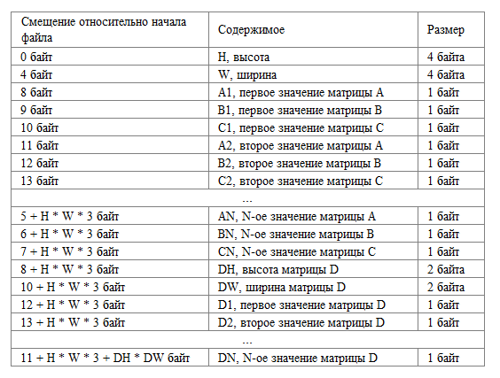
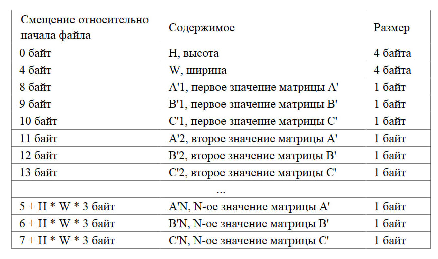
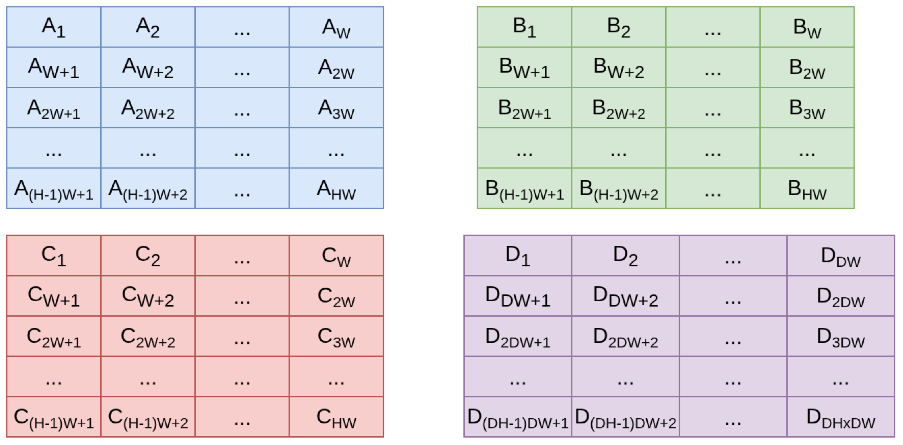

# <u>Техническое задание</u>

**Напишите программу на С.**

Программа должна принимать имя входного файла через флаг -i и имя выходного файла через флаг -o. Если какое-то из имён файлов не задано, то программа должна завершиться с кодом возврата 10.

Пример запуска программы: `./prog -o output.dat -i ../test/input.bin`

## Формат данных

Входной файл имеет следующий формат:



Пример входного файла. Матрицы A, B и C имеют размер H = 4, W = 3.

* Матрица A содержит значения от 1 до 12 (A1 = 1, A2 = 2, ..., A12 = 12)
* Матрица B содержит значения от 101 до 112 (B1 = 101, B2 = 102, ..., B12 = 112)
* Матрица C содержит значения от 201 до 212 (C1 = 101, C2 = 102, ..., C12 = 112)
* Матрица D имеет размер DH = 3, DW = 3. Матрица содержит значения от 1 до 9 (D1 = 1, D2 = 2, ... , D9 = 9)

```bin
00000000  04 00 00 00 03 00 00 00  01 65 c9 02 66 ca 03 67  |.........e..f..g|
00000010  cb 04 68 cc 05 69 cd 06  6a ce 07 6b cf 08 6c d0  |..h..i..j..k..l.|
00000020  09 6d d1 0a 6e d2 0b 6f  d3 0c 70 d4 03 00 03 00  |.m..n..o..p.....|
00000030  01 02 03 04 05 06 07 08  09                       |.........|
00000039
```

Выходной файл имеет следующий формат:



Пример выходного файла:

```bin
00000000  04 00 00 00 03 00 00 00  5e 85 ac 9a 26 ad 6a f7  |........^...&.j.|
00000010  89 ba df 09 22 10 f9 ba  7d 40 22 47 6c a9 97 85  |...."...}@"Gl...|
00000020  10 ce 91 9a f8 5b d9 3a  96 82 4b 14              |.....[.:..K.|
0000002c
```

В файлах используется нативный для системы endianess. Примеры файлов выше используют little-endian формат.
Все значения являются беззнаковыми, кроме D1-DN (**матрица D содержит в себе знаковые числа**).

Таким образом, во входном файле хранится четыре матрицы:


## Задача

**Для матриц A, B, C программа должна выполнить свертку с ядром D** ([Что такое свертка, wikipedia](https://en.wikipedia.org/wiki/Convolution#Discrete_convolution)).

* Элементы за пределами матрицы считать равными 0
* Гарантируется, что DH и DW являются нечётными значениями
* Если результирующие значение превышает 255, то взять его по модулю 251
* Если результирующие значение меньше 0, то изменить его знак и взять по модулю 241

## Дополнительная информация

Где взять скрипт:
Открытый тестовый набор и скрипт для запуска тестов находятся по ссылке: <https://drive.yadro.com/s/6dRjASFFR4XkF5m>

<u>**Как прислать решение на проверку:**</u>

* нажми "Добавить ответ на задание", появится возможность загрузить файл с решением;
* прикрепи только один исходный файл размером до 1МБайт  на языке программирования С (стандарт языка: C17, компилятор: gcс);
* ответ нужно отправить до 23:59 мск 8 октября 2026 года;
* после отправки файла с ответом его нельзя будет поменять.

<u>*Внимание*</u>: после завершения тестирования для всех, последнее отправленное решение будет запущено на закрытом наборе тесте, а также будет оценено качество кода. Поэтому прохождение открытых тестов не означает полностью правильное решение задания и прохождение этапа отбора!